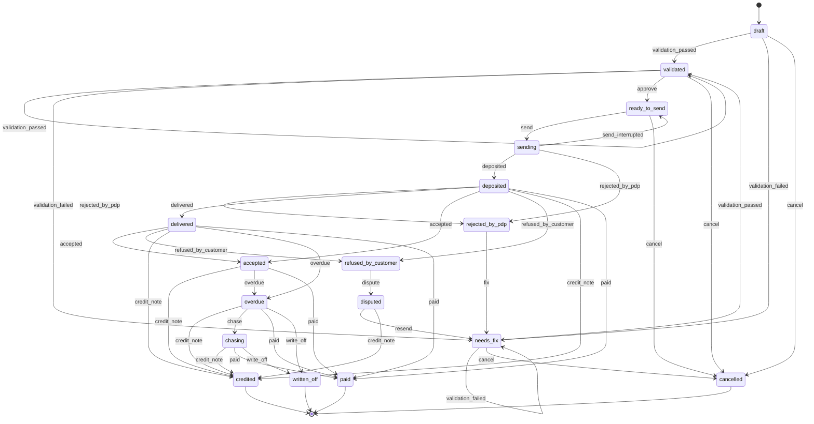

<!-- Generated by `pnpm --filter @fi/core gen:docs` from packages/core. Do not edit by hand. -->

# Invoice state machine

`transition(from, event, actor)` in packages/core/src/state.ts is the only way to change an invoice status. It refuses an event that is not allowed from the current state, or by that kind of actor.

States (17): `draft`, `needs_fix`, `validated`, `ready_to_send`, `sending`, `deposited`, `rejected_by_pdp`, `delivered`, `refused_by_customer`, `disputed`, `accepted`, `overdue`, `chasing`, `paid`, `written_off`, `credited`, `cancelled`.

Terminal states: `paid`, `written_off`, `credited`, `cancelled`.

| Event | From | To | Who | Note |
|---|---|---|---|---|
| validation_passed | draft, needs_fix, validated | validated | system | The deterministic core found no blocking issue. |
| validation_failed | draft, needs_fix, validated | needs_fix | system | The deterministic core found at least one blocking issue. |
| approve | validated | ready_to_send | user, system | The user clicks « Envoyer », or the autopilot policy of the tenant passes. |
| send | ready_to_send | sending | user, system | The send job starts. Its idempotency key is tenant + number + fingerprint. |
| send_interrupted | sending | ready_to_send | system | Network or PDP outage; the job retries with the same idempotency key. |
| deposited | sending | deposited | pdp, system | The platform accepted the file (« Déposée »). |
| rejected_by_pdp | sending, deposited | rejected_by_pdp | pdp | The platform refused the file (« Rejetée »). Nothing reached the customer. |
| fix | rejected_by_pdp | needs_fix | user, system | Back to the sheet to correct the invoice. |
| delivered | deposited | delivered | pdp | Made available to the customer (« Mise à disposition »). |
| accepted | deposited, delivered | accepted | pdp | The customer approved it (« Approuvée »). |
| refused_by_customer | deposited, delivered | refused_by_customer | pdp | The customer refused it (« Refusée »), with a reason. |
| dispute | refused_by_customer | disputed | user, system | The refusal is being handled; chasing pauses. |
| resend | disputed | needs_fix | user | The user corrects the invoice and sends it again (validation runs again). |
| credit_note | disputed, deposited, delivered, accepted, overdue, chasing | credited | user, system | Cancelled by a credit note; after deposit this is the only way to cancel. Applied when the platform has the credit note. |
| overdue | delivered, accepted | overdue | system | Daily job: the due date has passed and no payment was recorded. |
| chase | overdue | chasing | system, agent | A chasing plan is active (CollectAgent). |
| paid | deposited, delivered, accepted, overdue, chasing | paid | user, pdp | Payment received (« Encaissée »), from the platform or recorded by the user. |
| write_off | overdue, chasing | written_off | user | The user gives up on the payment. |
| cancel | draft, needs_fix, validated, ready_to_send | cancelled | user | Only before the platform has the invoice; never while it is being sent. |

Who: `user` (a click in the add-in), `pdp` (platform webhook or polling), `system` (our jobs and the deterministic core), `agent` (one of our agents, e.g. CollectAgent).
